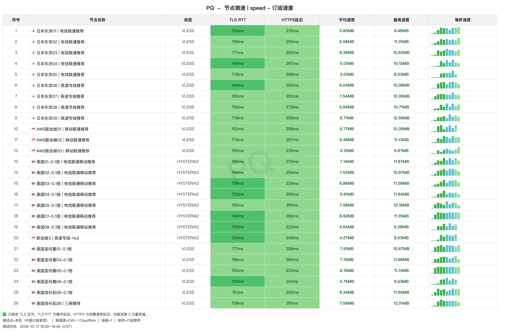

# 赔钱机场｜1.5 元/月 100G（2026-10-27 更新）

> **一句话评价：重度用户之选：0.1 倍节点额度翻 10 倍，最大单档 20TB**
>
> **本次实测：连通 26 / 共 83 节点**，延迟中位 154 ms，速度中位 6.5 MB/s。
>
> 👉 **[官网注册](https://xn--mes358aby2apfg.com/register?code=qhyiSP1G&cover=sfw)** · 月付起步 1.5 元，先试再升级。

**适合：**

- 大流量下载、挂 PT、频繁看 4K
- 认准 0.1 倍率：同样额度实际能传 10 倍数据
- 美区用户（0.1 倍节点集中在美区）

| | |
|---|---|
| 起步价 | 1.5 元/月 100G |
| 节点 | 83 个（本次 26 个连通） |
| 延迟中位 | 154 ms |
| 速度中位 | 6.5 MB/s |
| 实测最快 | 9.2 MB/s |
| 计费倍率 | 含 12 个 0.1 倍节点 |
| 协议 | VLESS / Hysteria2 |

## 套餐

| 套餐 | 流量 | 设备 | 限速 | 一次付 | 月付 | 季付 | 半年 | 年付 | 两年 | 三年 |
|---|---|---|---|---|---|---|---|---|---|---|
| 大瓶可乐 | 1000G | 20 | 不限 | — | **5.99 元** | — | 34.99 | 68.99 | 133.99 | 199.99 |
| 超大瓶可乐 | 5000G | 30 | 不限 | — | **12.99 元** | — | 73.99 | 139.99 | 265.99 | 375.99 |
| 水桶可乐 | 20000G | 40 | 不限 | — | **39.99 元** | — | 225.99 | 429.99 | 810 | 1150.99 |
| 中瓶可乐 | 500G | 15 | 不限 | — | **2.99 元** | — | 17.99 | 34.99 | 68.99 | 99.99 |
| 一瓶盖可乐 | 100G | 10 | 不限 | — | **1.50 元** | — | 9 | 18 | 36 | 54 |
| 企业套餐(300台设备数量支持) | 99999G | 300 | 不限 | — | **280 元** | 798 | 1515 | 2888 | 5488 | 8088 |
| 一会嗦一口(不限时长永久订阅) | 1000G 一次性 | 10 | 不限 | **18.90 元** | — | — | — | — | — | — |
| 一会嗦(不限时长永久订阅) | 4000G 一次性 | 20 | 不限 | **68.90 元** | — | — | — | — | — | — |
| 一大口(不限时长永久订阅) | 6000G 一次性 | 30 | 不限 | **88.99 元** | — | — | — | — | — | — |
| 至尊订阅(不限时长永久订阅) | 20000G 一次性 | 40 | 不限 | **228.80 元** | — | — | — | — | — | — |
| 顶级王冠99999GB流量订阅(不限时长永久订阅) | 99999G 一次性 | 300 | 不限 | **688 元** | — | — | — | — | — | — |

> 月流量按 20% 用量限速为「每天流量限制为总的20%」的公平使用；0.1 倍节点计入同额度，实际可用量约为标称 10 倍。

**每元流量**：月付约 67～500 GB/元（一瓶盖可乐 ～ 水桶可乐）

## 测速

本次 连通 26 / 共 83 节点：节点平均速度最高 9.2 MB/s，完整记录见下图与 `data/`，每节点连测 3 次取最优（2026-10-17 18:39–18:48，中国大陆家宽出口香港）。

| 节点 | 协议 | 延迟 | 完整请求 | 平均速度 | 最高速度 |
|---|---|---|---|---|---|
| 🇺🇸美国圣何塞05-0.1倍 | VLESS | 152ms | 223ms | **9.15 MB/s** | 11.14 MB/s |
| 🇺🇸美国07-0.1倍 \| 电信联通移动推荐 | HYSTERIA2 | 149ms | 280ms | **8.92 MB/s** | 11.15 MB/s |
| 🇺🇸美国洛杉矶08-0.1倍 | VLESS | 151ms | 292ms | **8.34 MB/s** | 11.60 MB/s |
| 🇺🇸美国圣何塞01-0.1倍 | VLESS | 177ms | 308ms | **7.91 MB/s** | 10.87 MB/s |
| 🇺🇸美国洛杉矶08 \| 三网推荐 | VLESS | 158ms | 261ms | **7.58 MB/s** | 12.01 MB/s |
| 🇯🇵日本东京07 \| 高速专线推荐 | VLESS | 165ms | 262ms | **7.54 MB/s** | 12.35 MB/s |
| 🇺🇸美国02-0.1倍 \| 电信联通移动推荐 | HYSTERIA2 | 184ms | 254ms | **7.52 MB/s** | 10.97 MB/s |
| 🇺🇸美国圣何塞03-0.1倍 | VLESS | 186ms | 264ms | **7.15 MB/s** | 11.66 MB/s |

*完整 26 个节点的测速记录见上图，逐节点原始数据见 `data/`。*

## 节点

83 个节点：美国 32 · 日本 20 · 香港 11 · 新加坡 9 · 台湾 3 · 澳大利亚 3 · 韩国 2 · 迪拜/瑞士/印度 各 1。0.1 倍节点集中在美区。

## 使用建议

- 日常走 0.1 倍节点，同样流量只扣十分之一
- 美国节点最多，0.1 倍节点集中在美区
- 节点名带「电信联通推荐」「三网推荐」的按运营商挑，少走弯路

## 注册

👉 **[官网注册](https://xn--mes358aby2apfg.com/register?code=qhyiSP1G&cover=sfw)** · 注册后在套餐页选周期，月付起步 1.5 元。

## 更新

- **2026-10-18** — 套餐价格复核（官网接口一瓶盖 1.5 元不变），公告无新增。
- **2026-10-17** — 83 个节点实测，26 个连通；0.1 倍节点 12 个。

---
*测速 2026-10-17 18:39–18:48，中国大陆家宽出口香港，每节点连测 3 次取最优。*

更多机场测评

- [机场对比总览](https://github.com/cw11ark/jichang-tuijian-2026)
- [秒连云 测评](https://github.com/cw11ark/miaolianyun-jichang)
- [赛博云 测评](https://github.com/cw11ark/saiboyun-jichang)
- [贝贝云 测评](https://github.com/cw11ark/beibei-jichang)

